<div align="center">

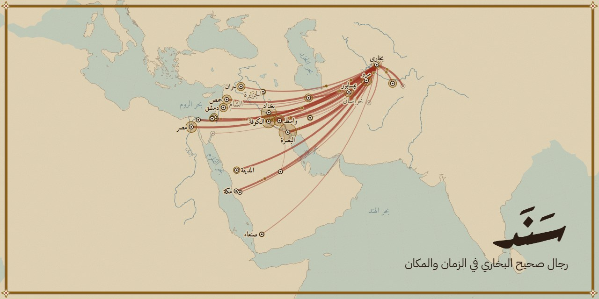

<h3 dir="rtl">رجال صحيح البخاري في الزمان والمكان</h3>

<p>


</p>

<a href="#english-summary">English summary</a>

</div>

<div dir="rtl">

**الموقع:** [sanad-kysl.onrender.com](https://sanad-kysl.onrender.com)

**«سَنَد»** موقع عربي يعرض كل حديث من صحيح البخاري مع رجال سنده واحداً واحداً، ثم يرويه على الخريطة وعلى خط الزمن: أين عاش رجاله، ومتى ماتوا، وكيف انتقل مركز الرواية من المدينة والكوفة والبصرة إلى بغداد ومرو وبخارى جيلاً بعد جيل. وبجانب كل راوٍ حكم ابن حجر عليه بلفظه في «تقريب التهذيب»، لا حكم من عندنا. والعربية فيه أولاً: نص الحديث كما هو بتشكيله، والأسماء والأرقام والأوصاف كلها بالعربية.

<p align="center">
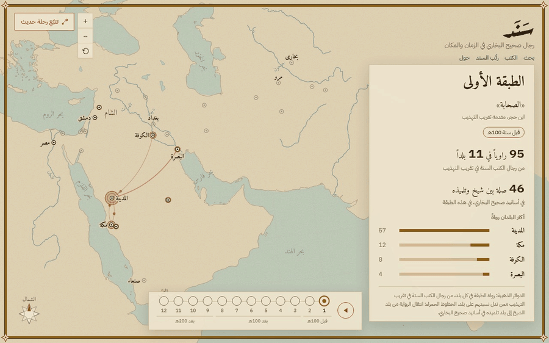
</p>
<p align="center"><sub>الطبقات من الصحابة إلى طبقة البخاري: الدوائر عدد الرواة في كل بلد، والخطوط انتقال الرواية من بلد الشيخ إلى بلد تلميذه.</sub></p>

## ماذا ترى فيه

<table>
<tr>
<td width="50%" valign="top">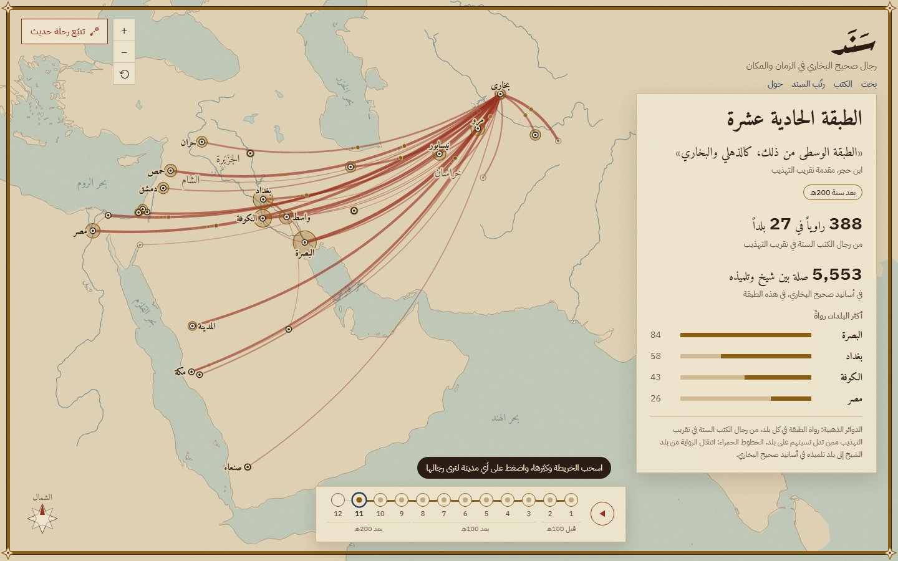<br><b>الخريطة الرئيسية</b><br>مواطن رجال الكتب الستة عبر الطبقات الاثنتي عشرة بلفظ ابن حجر، تُشغَّل طبقة بعد طبقة، وفي كل بلد أشهر رجاله مع أحكامهم.</td>
<td width="50%" valign="top">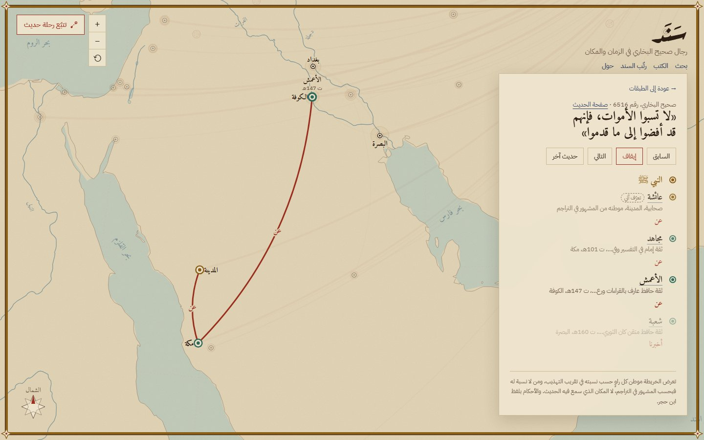<br><b>تتبّع رحلة حديث</b><br>أحاديث مختارة يُرسم سندها على الخريطة راوياً بعد راوٍ، من الصحابي إلى البخاري، وصيغ التحمّل على وصلاته.</td>
</tr>
<tr>
<td valign="top">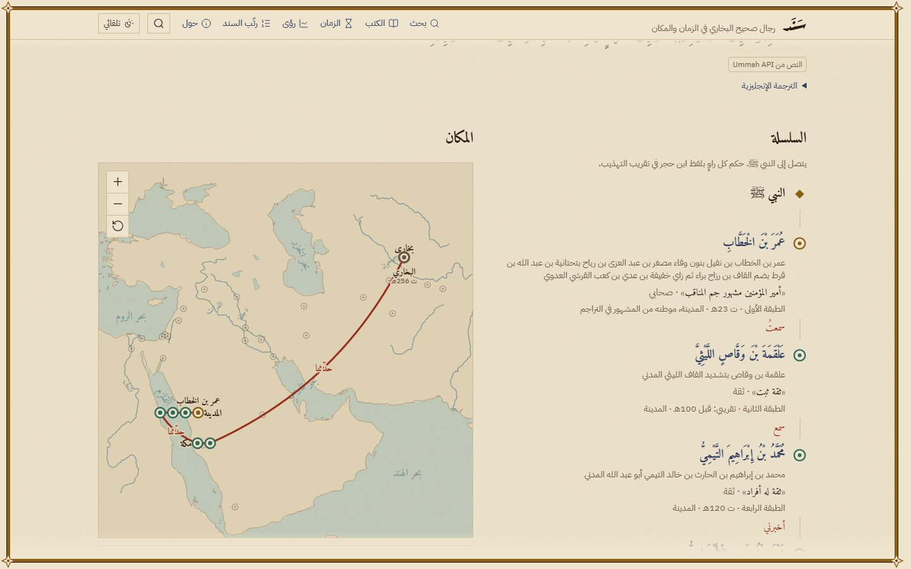<br><b>صفحة الحديث</b><br>النص من Ummah API بصيغ التحمّل ملوّنة، والسند يُروى على الخريطة ويضيء صاحبه في العمود وعلى الشريط الزمني، ثم ملخص الطريق.</td>
<td valign="top">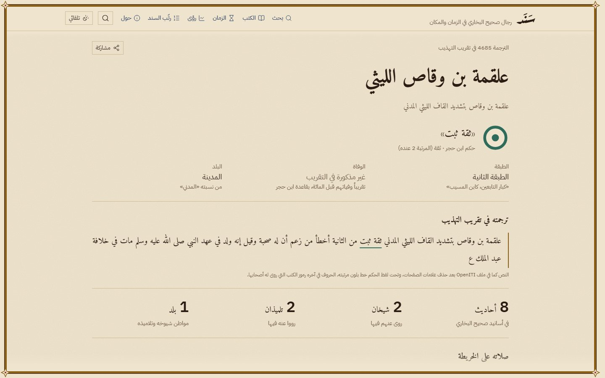<br><b>صفحة الراوي</b><br>ترجمته كاملة وتحت لفظ الحكم خط بلون مرتبته، وأعداده، وخريطة صلاته بشيوخه وتلاميذه، وأحاديثه.</td>
</tr>
<tr>
<td valign="top">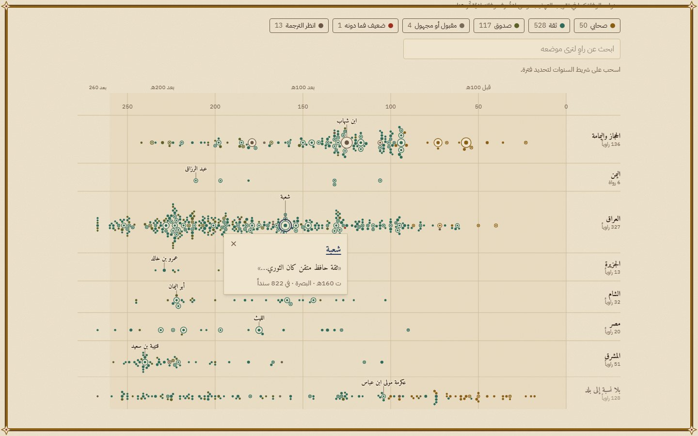<br><b>الزمان</b><br>كل راوٍ له سنة وفاة معروفة دارة على محور من 0 إلى 260هـ، صف لكل إقليم، بلون مرتبته وحجم بعدد أسانيده. اسحب على المحور لتحديد فترة، وابحث عن راوٍ لترى موضعه.</td>
<td valign="top">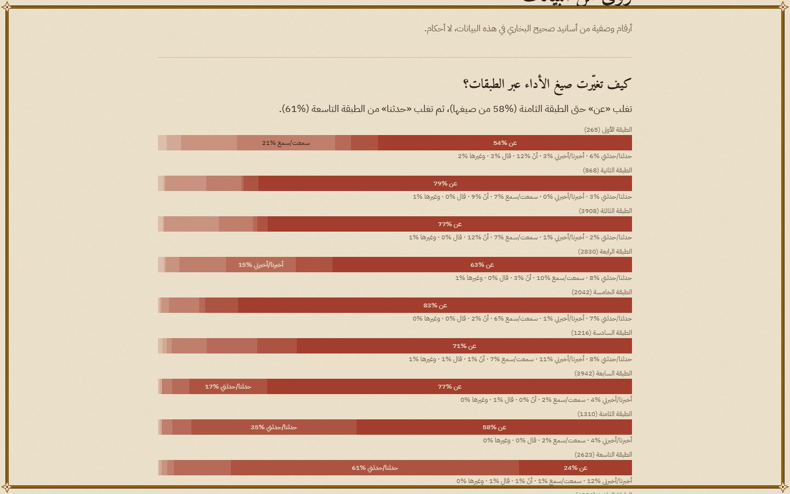<br><b>رؤى من البيانات</b><br>أربعة أسئلة تجيب عنها الأرقام: تغيّر صيغ الأداء عبر الطبقات، ومواطن كل طبقة، وأطوال الأسانيد التامة، وأكثر الرواة صلات.</td>
</tr>
<tr>
<td valign="top">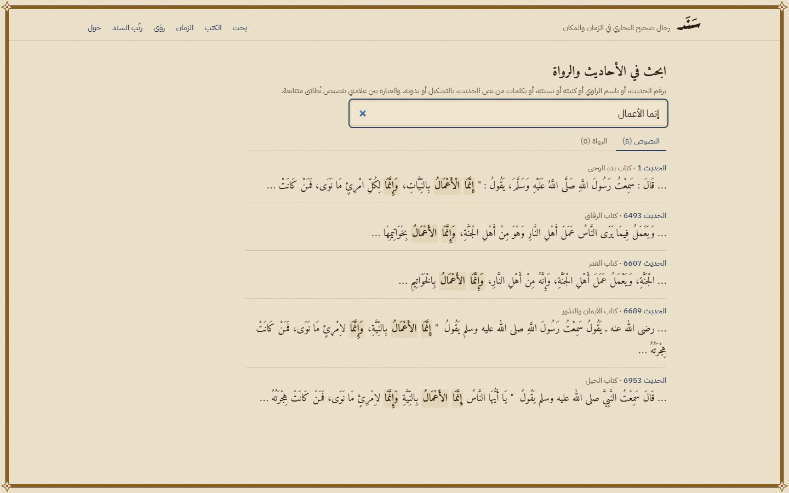<br><b>البحث</b><br>حقل واحد: الرقم يفتح الحديث، والاسم يبحث في الرواة، والكلمات تبحث في نصوص الأحاديث بلا تشكيل ولا همزات، والعبارة بين علامتي تنصيص تُطابَق متتابعة.</td>
<td valign="top">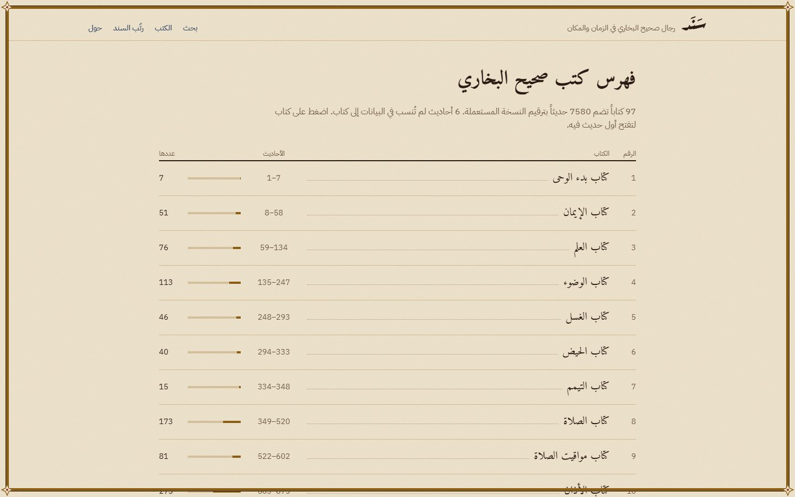<br><b>فهرس الكتب</b><br>كتب الصحيح كفهرس المخطوط: رقم كل كتاب وعنوانه ومدى أحاديثه وعددها.</td>
</tr>
<tr>
<td valign="top" align="center" colspan="2">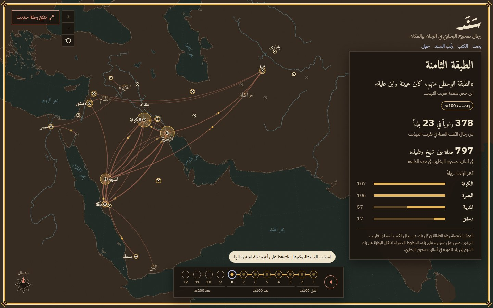<br><b>حبر وطين</b><br>الوضع الداكن يتبع إعداد الجهاز، بالأصباغ نفسها مضاءة.</td>
</tr>
<tr>
<td valign="top" align="center">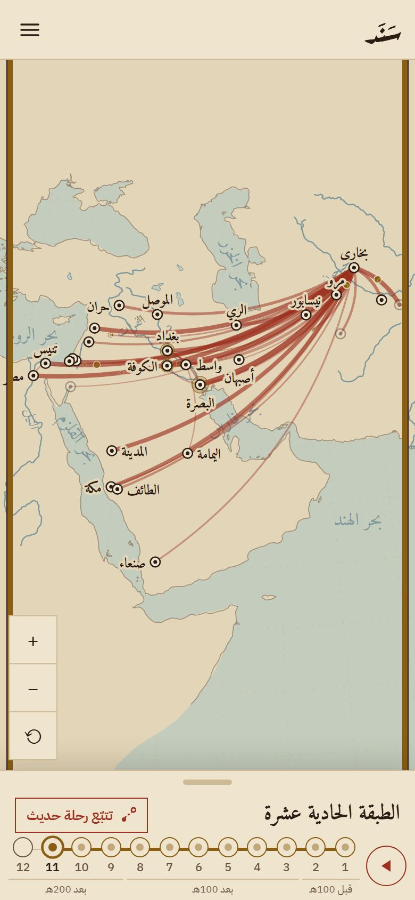<br><b>على الهاتف</b><br>الخريطة تملأ الشاشة، واللوحة سفلية بثلاثة ارتفاعات، وأسماء المدن لا تتراكب.</td>
<td valign="top" align="center">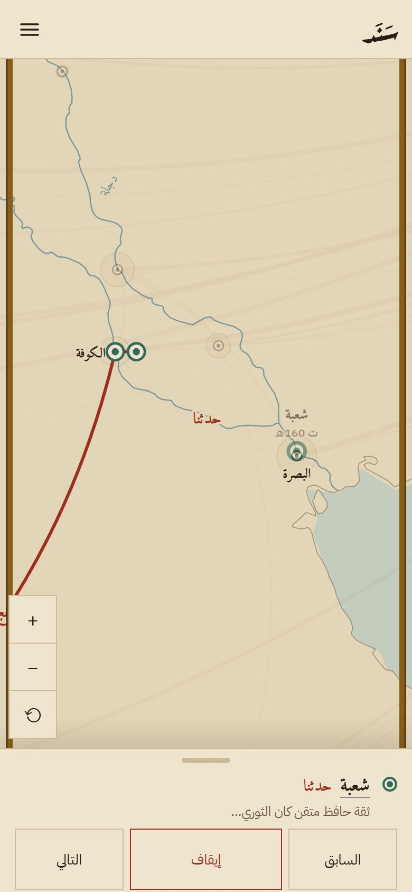<br><b>الرحلة على الهاتف</b><br>اللوحة تعرض الراوي الحالي وحكم ابن حجر وصيغة التحمّل، والكاميرا تتبعه فوقها.</td>
</tr>
</table>

ومعها لعبة «رتّب السند». والخرائط داخل الصفحات معاينة على الهاتف، يفتحها زر بملء الشاشة.

## صفحة من مخطوط

الموقع صفحة من مخطوط حديثي: الأرضية رَقّ، والنص مداد، والألوان أصباغ ترابية كانت تُستعمل في المخطوطات، وحول كل صفحة جدول مسطّر بالمداد والمغرة.

<p align="center">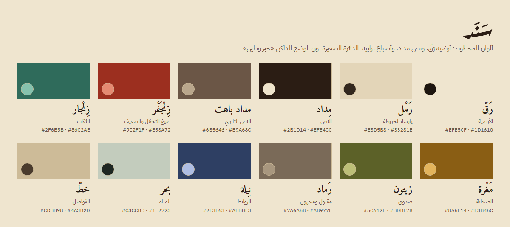</p>

- **الألوان:** الزِّنجفر لصيغ التحمّل ولمجموعة الضعيف فقط، والمغرة للصحابة، والزنجار للثقات، والزيتون للصدوق، والرماد للمقبول والمجهول. ولا يُعتمد على اللون وحده: لفظ الحكم مكتوب بجانب كل راوٍ. والوضع الداكن «حبر وطين» يتبع إعداد الجهاز.
- **الخطوط:** Amiri لنص الحديث والعناوين، وIBM Plex Sans Arabic للواجهة والأرقام، وAref Ruqaa للشعار وحده. والأرقام غربية كما في الجزائر، والوفاة بصيغة «ت 256هـ».

**الدارة:** قال ابن الصلاح في المقدمة (النوع الخامس والعشرون): «ينبغي له أن يجعل بين كل حديثين دارة تفصل بينهما وتميز»، ونقل: «واستحب الخطيب الحافظ أن تكون الدارات غفلا، فإذا عارض فكل حديث يفرغ من عرضه ينقط في الدارة التي تليه نقطة».

فكل راوٍ في «سَنَد» دارة على هذا المعنى: **منقوطة** إن عُرفت ترجمته في التقريب، و**غُفل** (فارغة) إن لم يُعرف صاحب الاسم، فيُكتب اسمه كما ورد في النص بلا تخمين. ولون الدارة من مرتبته عند ابن حجر.

## المنهج والبيانات

</div>

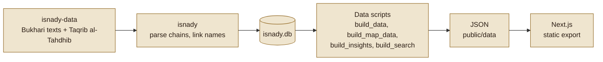

<div dir="rtl">

**قواعد الدقة**

- لا يصدر الموقع حكماً على حديث ولا على راوٍ: ينقل حكم ابن حجر بلفظه، ويستعمل مرتبته للتلوين فقط.
- لا تخمين: الراوي الذي لم يُعرف يُعرض باسمه كما ورد في النص.
- الخرائط تعرض مواطن الرواة لا أماكن السماع. والموطن من نسبة الراوي في ترجمته، ومن لا نسبة له من أكثر الرجال وروداً فموطنه من المشهور في التراجم، ويُكتب ذلك معه.
- «يتصل إلى النبي ﷺ» تُكتب حين تذكر الأداة أن السند ينتهي إليه فقط، ولا يُستنتج منها رفع ولا وقف.
- نصوص الأحاديث تُعرض كما هي، و«ﷺ» بعد ذكر النبي في الواجهة.
- كل رقم في الواجهة محسوب من البيانات، لا مكتوب باليد.

**حدود البيانات** (محسوبة من ملفات `public/data`)

- رُبط 30,471 اسماً من 40,096 في الأسانيد بتراجمها (76%)، وعُرف كل رجال 2,357 سنداً من 8,085 (29%).
- في الأسانيد 1,282 راوياً مختلفاً: لـ96% منهم طبقة، ولـ72% نسبة إلى بلد، ولـ56% سنة وفاة. و38 منهم موطنهم من المشهور في التراجم.
- استخراج الحكم آلي وناقص عند بعض كبار الأئمة، فالترجمة الكاملة في صفحة كل راوٍ هي المرجع، ووسم «تعرّف آلي» يعني أن الأداة لم تقطع بصاحب الاسم.
- 45 سنداً لم يوجد نصها داخل نص الحديث فتُعرض بلا تلوين، و21 سنداً تعتمد على سند الحديث الذي قبلها. والتعاليق بعد المتن لا تستخرجها الأداة.
- دوائر الخريطة لـ4,977 من رواة التقريب البالغين 8,824 (56%) ممن تدل نسبتهم على بلد، على 31 مدينة وإقليماً. وخطوطها من 21,783 صلة بين شيخ وتلميذه في أسانيد البخاري عُرف بلداهما.
- 6 أحاديث لم تُنسب في البيانات إلى كتاب من كتب الصحيح الـ97.
- سنوات الوفاة من استخراج آلي: 713 راوياً من 1,282 لهم سنة وفاة، ومن لا تُعرف وفاته لا يُقدَّر في صفحة الزمان. و8 منهم تقع وفاتهم في البيانات بعد 260هـ فيُعرضون في شريط بعد المحور، وقد يكون القرن فيها خطأ من الأداة حين يحذفه ابن حجر.

## التقنية

- Next.js 16 بتصدير ثابت، وTypeScript، وTailwind 4. لا خادم ولا قاعدة بيانات وقت التشغيل.
- الصفحات بمعاملات الرابط (`/hadith/?n=1`، `/narrator/?id=4685`) بدل آلاف الصفحات الثابتة.
- البيانات ملفات JSON في `public/data/` يولّدها Python (بمكتبة sqlite3 المدمجة) من `isnady.db`، وتُرفع مع المستودع فلا يحتاج النشر إلى Python.
- كل الخرائط تُرسم من خريطة أساس مسقطة مسبقاً (`geometry.json`) بوحدة مشتركة في `src/components/sanad-map/core.ts`، وd3 للتكبير والحركة. وموطن كل راوٍ من دالة واحدة (`home_of`) يستعملها مولّدا البيانات، فلا تختلف الخرائط.
- نص الحديث يُجلب من Ummah API في المتصفح بمهلة قصيرة، وإن تعذّر عُرض نصنا بلا رسالة خطأ.
- على الهاتف لوحة بثلاثة ارتفاعات تتحرك بـtransform، وأسماء المدن تُختار بالأولوية فلا تتقاطع، والرسم أخف: بلا مزج ألوان ولا تعتيم، و6 شهب بدل 14، وكل تحديثات الإيماءة في إطار واحد. وتجربة الحاسوب لا تتغير بشيء من ذلك.
- البحث في النصوص بفهرس يولّده `scripts/build_search.mjs` للمتن وحده، مقسّم إلى ملفات صغيرة بحسب أول حروف الكلمة، فلا يُحمَّل إلا ما تحتاجه الكلمات المكتوبة، والتطبيع نفسه (`src/lib/arabic.mjs`) عند البناء وفي المتصفح.
- الخطوط مستضافة مع الموقع، والحركة كلها تحترم إعداد تقليل الحركة.

<details>
<summary><b>التشغيل محلياً</b></summary>

<div dir="ltr">

```bash
npm ci
npm run dev        # http://localhost:3000
npm run build      # the static site, in out/
npm start          # serve out/ locally
```

</div>

</details>

<details>
<summary><b>توليد البيانات</b></summary>

يحتاج Python 3 وgit، ولا حاجة إليه للنشر لأن البيانات مرفوعة. الأوامر لـbash:

<div dir="ltr">

```bash
git clone --depth 1 --filter=blob:none --no-checkout https://github.com/bayramkotan/isnady-data data-src/isnady-data
git -C data-src/isnady-data sparse-checkout set --no-cone /catalog.json /sunni/sahih_al_bukhari/book.json /sunni/sahih_al_bukhari/ara.json /sunni/sahih_al_bukhari/eng.json /rijal/sunni/
git -C data-src/isnady-data checkout
python -m venv .venv-isnady
.venv-isnady/bin/pip install --no-deps isnady    # Windows: .venv-isnady/Scripts/pip
IY=.venv-isnady/bin/iy
$IY repo add "$PWD/data-src/isnady-data"
$IY repo use isnady-all-sources-default
$IY catalog import sahih_al_bukhari --language ara --language eng
$IY catalog import taqrib_al_tahdhib_ibn_hajar_al_asqalani
npm run data       # hadith and narrator files, the map, the insights, the search index
```

</div>

</details>

## النشر على Render

موقع ثابت (Static Site)، وأمر البناء `npm ci && npm run build`، ومجلد النشر `out`. والإعداد نفسه في `render.yaml` لمن ينشر بـBlueprint.

## المصادر والرخص

- [isnady](https://github.com/bayramkotan/isnady) (رخصة MIT): قراءة الأسانيد وربط الرواة بتراجمهم، عبر [isnady-data](https://github.com/bayramkotan/isnady-data).
- نصوص الأحاديث من [fawazahmed0/hadith-api](https://github.com/fawazahmed0/hadith-api) (Unlicense)، ونص صفحة الحديث من [Ummah API](https://ummahapi.com).
- «تقريب التهذيب» لابن حجر العسقلاني من [OpenITI](https://openiti.org)، بتحقيق محمد عوامة (دار الرشيد، 1986).
- عناوين كتب الصحيح بالعربية من [AhmedBaset/hadith-json](https://github.com/AhmedBaset/hadith-json).
- خريطة الأساس من [Natural Earth](https://www.naturalearthdata.com) (ملكية عامة) عبر [world-atlas](https://github.com/topojson/world-atlas) (رخصة ISC)، والرسم بـ[d3](https://d3js.org) (رخصة ISC).
- الخطوط Amiri وIBM Plex Sans Arabic وAref Ruqaa (رخصة SIL OFL 1.1) عبر Fontsource.

</div>

## English summary

**Live site:** [sanad-kysl.onrender.com](https://sanad-kysl.onrender.com)

**Sanad** (*the chain of narrators*) is an Arabic-first site that shows every hadith of Sahih al-Bukhari with the men of its chain one by one, and tells that chain on a map and a timeline: where its narrators lived, when they died, and how the centre of transmission moved from Medina, Kufa and Basra to Baghdad, Merv and Bukhara over twelve generations. Beside each narrator stands Ibn Hajar's verdict in his own words, from *Taqrib al-Tahdhib*; the site issues no grading of its own.

- **Home map:** where the narrators of the six books lived, generation by generation, with the flow of transmission from teacher's city to student's city, and featured hadiths whose chains can be followed step by step.
- **Hadith page:** the Arabic text (from the Ummah API) with transmission words marked; the chain told on the map from the Companion to al-Bukhari, lighting each narrator in the chain column and on the death-year timeline.
- **Narrator page:** the full Taqrib entry, count-ups, a map of his teachers and students, and his hadiths.
- **Time page:** every narrator with a known death year on an axis from 0 to 260 AH, in a row for each region; drag on the axis to pick a period.
- **Search:** one field that opens a hadith by number, finds narrators by name, and searches the hadith texts through an index split into small files, so only what the typed words need is loaded.
- **Insights:** four questions answered from the data, with every figure computed: how the transmission words changed across the generations, where each generation lived, how many men stand in a full chain, and who is the most connected narrator. Also a table of books and an *order the chain* game.
- **On phones:** the map fills the screen above a three-stop sheet, city names never overlap, the drawing is lighter, and maps inside pages open full screen. The desktop is untouched by any of it.
- **Tech:** Next.js 16 static export, TypeScript, Tailwind 4; data pre-built as JSON by Python from the isnady database; maps drawn with d3 on a pre-projected Natural Earth base map. No server and no database at run time.
- **Sources:** isnady (MIT), hadith texts from fawazahmed0/hadith-api (Unlicense), Taqrib al-Tahdhib from OpenITI, the Ummah API, Natural Earth (public domain) via world-atlas (ISC), d3 (ISC), fonts under the SIL OFL.
